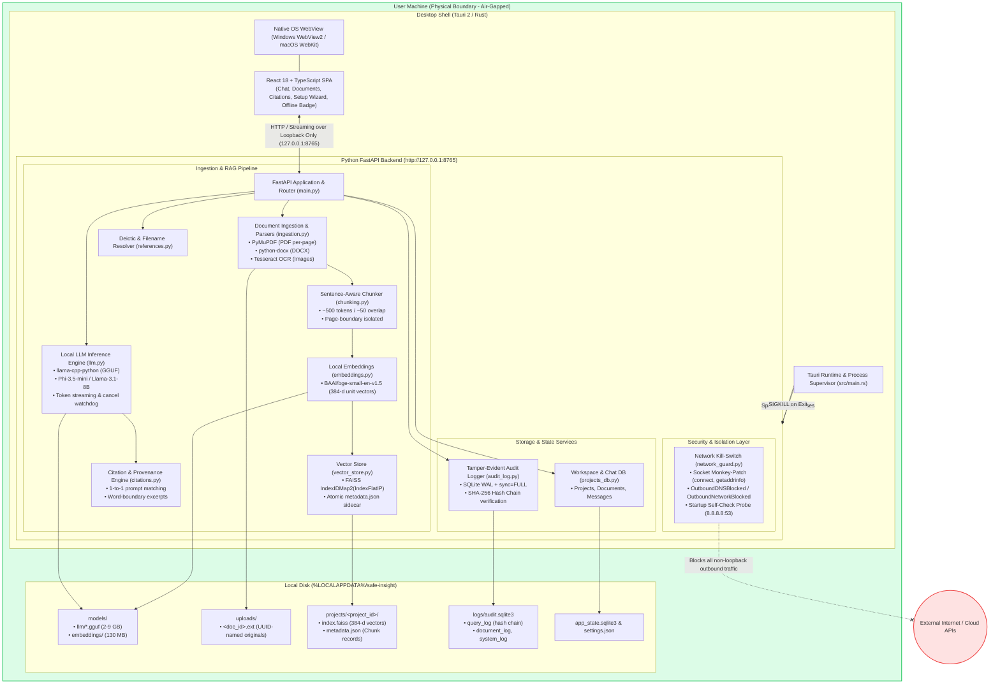
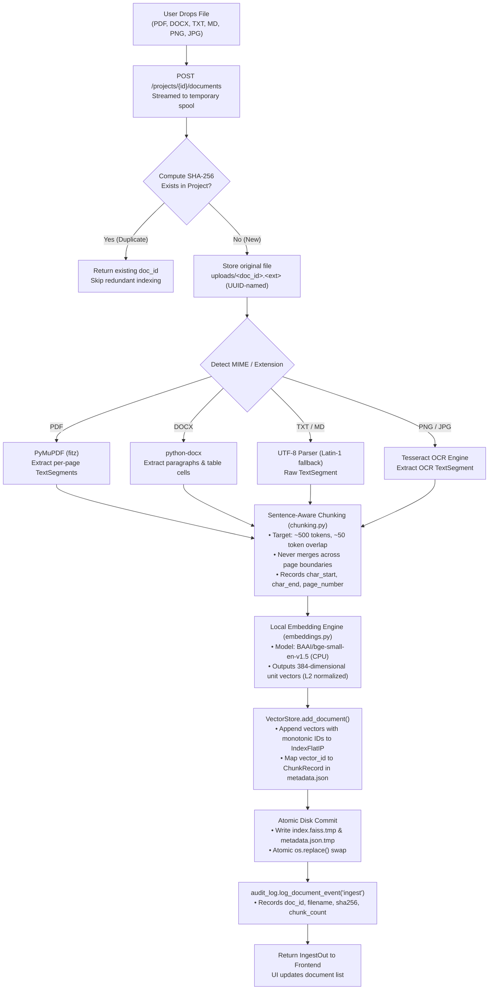
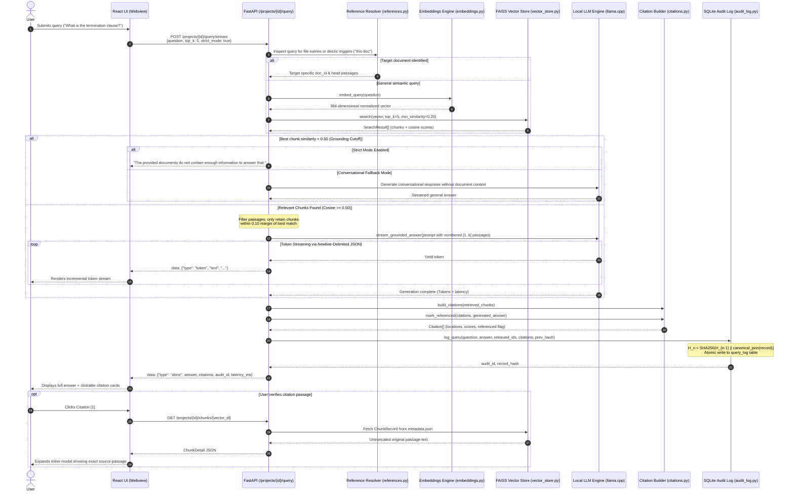
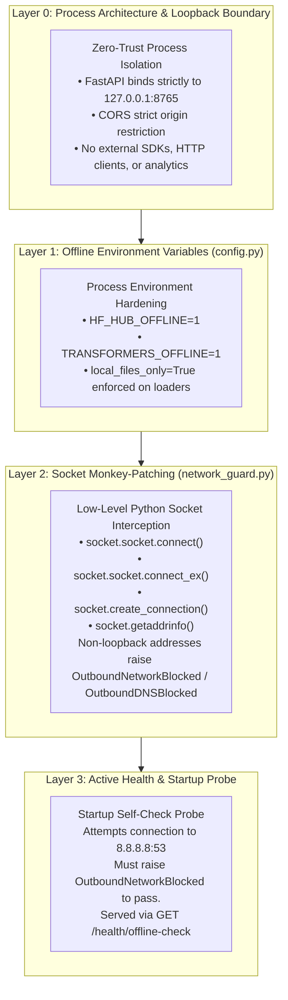

# Safe Insight

<div align="center">


**Air-gapped, zero-telemetry, verifiable document intelligence for regulated industries.**

[](../LICENSE)
[](https://www.python.org/)
[](https://tauri.app/)
[](https://react.dev/)
[](https://fastapi.tiangolo.com/)
[](https://github.com/facebookresearch/faiss)
[](https://github.com/ggerganov/llama.cpp)
[](https://github.com/Akarshhk/Safe-Insight)
[](https://github.com/Akarshhk/Safe-Insight)

</div>

---

## Executive Summary

**Safe Insight** is a desktop application providing retrieval-augmented generation (RAG) over private, highly sensitive documents without permitting a single byte of data to exit the physical host machine. 

Modern enterprise AI systems routinely stream proprietary documents to third-party cloud APIs (such as OpenAI, Anthropic, or cloud-hosted vector databases). In regulated sectors—including **healthcare (HIPAA)**, **legal practice (attorney-client privilege)**, **financial compliance (SEC/FINRA/SOX)**, and **defense contracting**—transmitting unredacted documents over public networks is often legally prohibited or contractually disqualified.

Safe Insight resolves this dilemma by running **100% of the ingestion, vector indexing, retrieval, and generative pipeline locally on ordinary CPU hardware**. The application enforces an airtight offline guarantee at the OS socket layer, provides strict mathematical provenance for every claim made by the language model, and logs every interaction into an immutable, SHA-256 hash-chained SQLite audit trail.

---

## Table of Contents

- [Executive Summary](#executive-summary)
- [Key Capabilities & Feature Matrix](#key-capabilities--feature-matrix)
- [System Architecture](#system-architecture)
  - [1. Process Topology & Boundaries](#1-process-topology--boundaries)
  - [2. Multi-Format Ingestion Pipeline](#2-multi-format-ingestion-pipeline)
  - [3. Retrieval-Augmented Generation & Citation Lifecycle](#3-retrieval-augmented-generation--citation-lifecycle)
  - [4. Multi-Layer Offline Enforcement](#4-multi-layer-offline-enforcement)
- [The 4-Layer Zero-Trust Network Guard](#the-4-layer-zero-trust-network-guard)
- [The Verifiable Citation Contract](#the-verifiable-citation-contract)
- [Tamper-Evident SHA-256 Audit Trail](#tamper-evident-sha-256-audit-trail)
- [Project Directory Layout](#project-directory-layout)
- [Prerequisites & System Requirements](#prerequisites--system-requirements)
- [Installation & Quick Start](#installation--quick-start)
  - [Step 1: Clone the Repository](#step-1-clone-the-repository)
  - [Step 2: Configure Python Backend](#step-2-configure-python-backend)
  - [Step 3: Provision Local Models](#step-3-provision-local-models)
  - [Step 4: Configure Frontend & Tauri Shell](#step-4-configure-frontend--tauri-shell)
  - [Step 5: Run Automated Verification Tests](#step-5-run-automated-verification-tests)
- [The 60-Second Live Viva / Compliance Demo](#the-60-second-live-viva--compliance-demo)
- [REST API Reference](#rest-api-reference)
- [Configuration Reference](#configuration-reference)
- [Engineering Decisions & Rationale](#engineering-decisions--rationale)
- [Troubleshooting & FAQ](#troubleshooting--faq)
- [Roadmap & Future Work](#roadmap--future-work)
- [License & Model Attribution](#license--model-attribution)

---

## Key Capabilities & Feature Matrix

| Feature | Implementation Mechanism | Compliance / Technical Benefit |
| :--- | :--- | :--- |
| **Air-Gapped Execution** | Python `socket` monkey-patching (`network_guard.py`) + offline env vars | Guarantees zero data egress. Verified via startup probe against `8.8.8.8:53`. |
| **Multi-Format Ingestion** | PyMuPDF (`fitz`), `python-docx`, standard text readers, Tesseract OCR | Supports PDF, DOCX, TXT, MD, and image uploads/screenshots (PNG/JPG). |
| **Page-Level Provenance** | Strict single-page `TextSegment` isolation during PDF extraction | Citations can unequivocally identify exact page numbers for PDF documents. |
| **Sentence-Aware Chunking** | Regex-based sentence boundary split with ~500-token window & ~50-token overlap | Eliminates mid-sentence cuts in citation cards; ensures coherent context passages. |
| **Local CPU Embeddings** | `BAAI/bge-small-en-v1.5` via `sentence-transformers` (PyTorch CPU) | Produces 384-dimensional unit vectors without requiring a dedicated GPU. |
| **Vector Indexing & Deletion** | FAISS `IndexIDMap2(IndexFlatIP)` with persistent JSON metadata sidecar | Exact cosine search with sub-millisecond retrieval; enables per-document deletion. |
| **Deictic & Named Search** | Heuristic resolver (`references.py`) for queries like *"what is in this doc?"* | Bypasses semantic embedding failures on abstract, meta-level questions. |
| **Local Generative AI** | `llama-cpp-python` running quantized GGUF weights (Phi-3.5-mini / Llama 3.1) | Zero cloud API dependencies; switchable models directly in application UI. |
| **Deterministic Citations** | 1-to-1 prompt numbering `[1..k]` matching citation payload arrays | Claims map directly to clickable cards and untruncated source passages. |
| **Tamper-Evident Audit** | Local SQLite database with cryptographic SHA-256 hash chains | Records queries, retrieved passages, model outputs; detects log modifications. |
| **Real-Time Streaming** | Newline-delimited JSON stream over loopback with 3-second watchdog ping | Lowers time-to-first-token to ~2 s on CPU; supports graceful client abort. |
| **Desktop Native Shell** | Tauri 2 (Rust) hosting native webview (WebView2 on Windows, WebKit on macOS) | Eliminates Electron's 150 MB+ Chromium overhead; supervises backend lifecycle. |

---

## System Architecture

Safe Insight operates as a tightly coupled, single-machine multi-process system: a lightweight **Tauri 2 Rust shell** supervising a local **FastAPI Python engine** over loopback HTTP.

### 1. Process Topology & Boundaries



---

### 2. Multi-Format Ingestion Pipeline

Safe Insight implements a dual-rail ingestion and indexing pipeline. Files are deduplicated via fast SHA-256 hashing prior to computationally expensive parsing. Each document format preserves spatial provenance (page numbers for PDFs, section indices for DOCX).



---

### 3. Retrieval-Augmented Generation & Citation Lifecycle

When a user submits a query, Safe Insight balances semantic vector search with deterministic deictic resolving. Prompt generation enforces strict grounded answering, and generations are streamed token-by-token with real-time abort capabilities.



---

### 4. Multi-Layer Offline Enforcement

Safe Insight uses **four concentric defense layers** to ensure complete network isolation. Simply omitting outbound network calls in user code is insufficient: deep transitive third-party dependencies can invoke telemetry or check update servers.



---

## The 4-Layer Zero-Trust Network Guard

The core security thesis of Safe Insight is: **A policy is not an architecture; isolation must be enforced by code.**

### 1. Layer 0: Process Architecture
- FastAPI binds explicitly to `127.0.0.1:8765` (loopback interface only). It rejects external LAN/WAN connections.
- Strict CORS configuration whitelists only Tauri's internal origins (`tauri://localhost`, `http://localhost:5173`).

### 2. Layer 1: Environmental Hardening
Before importing any machine-learning library, `app/config.py` sets:
```python
os.environ["HF_HUB_OFFLINE"] = "1"
os.environ["TRANSFORMERS_OFFLINE"] = "1"
```
Every Hugging Face and PyTorch loader is invoked with `local_files_only=True`.

### 3. Layer 2: Kernel/Socket Interception
In `app/network_guard.py`, Python's core socket primitives are monkey-patched **before** any ML dependencies are loaded:
- `socket.socket.connect`
- `socket.socket.connect_ex`
- `socket.create_connection`
- `socket.getaddrinfo` (patches DNS resolution to prevent DNS-leak telemetry)

Any destination IP that is not loopback (`127.0.0.1`, `::1`, `localhost`) raises `OutboundNetworkBlocked` or `OutboundDNSBlocked`. All escape attempts are appended to an in-memory violation ring buffer (`_violations`).

### 4. Layer 3: Active Probe & Live Verification
During application initialization, the backend intentionally attempts to open a socket to a public DNS IP (`8.8.8.8:53`).
- If the connection **succeeds**, the guard has failed: the backend logs an emergency error and marks offline status as false.
- If the connection **is refused** with `OutboundNetworkBlocked`, the guard is verified intact.
- The UI features a live **"Offline Mode: Verified"** badge. Clicking this badge triggers `GET /health/offline-check?rerun=true`, executing a fresh live probe and displaying active socket metrics.

#### The Sanctioned Model Download Exception
During first-run initialization or explicit user model downloads, the application permits a strictly scoped download window:
- Scoped to `huggingface.co` and its official CDN domains.
- Managed via Python `contextvars.ContextVar` to ensure only the worker thread executing the download is permitted outbound access.
- Every byte, timestamp, and model hash is logged to the `system_log` table in SQLite.
- The UI status badge immediately shifts from green to yellow ("Downloading Model") to prevent deceptive security claims.

---

## The Verifiable Citation Contract

Hallucinations are fatal in regulated settings. Safe Insight solves this by enforcing an invariant between retrieved context and generative output:

```
[Prompt Injection] Passage k  <====== identical index ======>  Citation[k] in JSON response
```

1. **Numbered Passages**: During prompt construction, passages are injected as numbered blocks:
   ```text
   Context passage [1] (from contract.pdf, page 4):
   "Either party may terminate this agreement upon thirty (30) days written notice..."
   ```
2. **In-Prompt Grounding Directives**:
   - The model is instructed: `"Cite the passage number in square brackets, e.g. [2], after every claim."`
   - In **Strict Mode**, rule 3 commands: `"If the passages do not contain the answer, reply exactly: 'The provided documents do not contain enough information to answer that.'"`
3. **Citation Extraction & Verification**:
   - `citations.py` parses the generated text using regex for markers like `[1]`, `[2, 3]`, and `[1][4]`.
   - Citations actually cited by the model are flagged with `referenced: true`.
   - The UI highlights referenced citations in primary colors and renders unreferenced (retrieved but uncited) passages in secondary styles, preserving full transparency.
4. **Relevance Filtering Margin**:
   - To protect CPU inference speeds, only chunks scoring within `SAFE_INSIGHT_RELEVANCE_MARGIN` (default: `0.10`) of the top-ranking passage are passed into the prompt.
5. **Exact Excerpt Inspection**:
   - The citation card displays a clean excerpt truncated on word boundaries.
   - Clicking any citation card queries `GET /projects/{id}/chunks/{vector_id}` to retrieve the full, untruncated source text directly from the metadata sidecar.

---

## Tamper-Evident SHA-256 Audit Trail

Every interaction is recorded in a local SQLite database (`%LOCALAPPDATA%/safe-insight/logs/audit.sqlite3`).

### 1. Cryptographic Hash-Chain Formula
Each record $n$ contains a SHA-256 digest calculated over its predecessor's hash combined with its own canonical JSON payload:

$$H_n = \text{SHA256}\Big(H_{n-1} \parallel \text{canonical\_json}(R_n)\Big)$$

Where:
- $H_0 = \text{SHA256}(\text{"0"}^{64} \parallel \text{canonical\_json}(R_1))$
- `canonical_json` sorts all keys alphabetically and eliminates extraneous whitespace to guarantee deterministic cross-platform hashing.
- Covered fields include: `query`, `answer`, `top_k`, `retrieved_ids`, `citations`, `documents_touched`, `model`, `embedding_model`, `latency_ms`, `project_id`, and `hash_version`.

### 2. Tamper Detection Engine
Endpoint `GET /audit/verify` iterates through all entries starting at ID 1, recalculating the hash chain. If a malicious actor edits a record's answer or deletes a row via raw SQL, the endpoint immediately detects the break, returning:
```json
{
  "valid": false,
  "checked": 42,
  "total": 100,
  "broken_at_id": 43,
  "detail": "Record 43 prev_hash does not match record 42 hash"
}
```

### 3. Regulatory Export (`POST /audit/export`)
For regulatory reviews (HIPAA audits, court subpoenas), the database can be exported to JSON Lines format (`audit_export.jsonl`) with a single click or API call.

---

## Project Directory Layout

```
Safe-Insight/
├── README.md                           ← Main repository documentation
└── safe-insight/                       ← Application root
    ├── ARCHITECTURE.md                 ← Technical companion & viva defence guide
    ├── README.md                       ← Submodule/package documentation
    ├── .gitignore                      ← Git exclusion rules
    │
    ├── backend/                        ← Python FastAPI backend
    │   ├── requirements.txt            ← Pinned local dependencies
    │   ├── download_model.py           ← Standalone model provisioning utility
    │   ├── tests/
    │   │   └── test_smoke.py           ← 32 fast, model-free unit & integration tests
    │   └── app/
    │       ├── __init__.py             ← Architectural module map
    │       ├── config.py               ← Centralized configuration & offline env vars
    │       ├── network_guard.py        ← Socket monkey-patch & startup self-check
    │       ├── setup.py                ← Model catalog, download manager & hot-swapper
    │       ├── models_catalog.json     ← Supported model catalog metadata & SHA-256
    │       ├── projects_db.py          ← SQLite workspace, document, and chat persistence
    │       ├── references.py           ← Deictic ("this doc") & filename query resolver
    │       ├── ingestion.py            ← Multi-format text extraction (PDF, DOCX, OCR)
    │       ├── chunking.py             ← Sentence-aware chunker with overlap & provenance
    │       ├── embeddings.py           ← Local BGE sentence-transformers encoder
    │       ├── vector_store.py         ← FAISS IndexIDMap2 + atomic JSON metadata sidecar
    │       ├── llm.py                  ← llama-cpp-python runner & grounded prompt builder
    │       ├── citations.py            ← Provenance builder & [n] marker parser
    │       ├── audit_log.py            ← SQLite audit log with SHA-256 hash chaining
    │       ├── schemas.py              ← Pydantic request & response models
    │       └── main.py                 ← FastAPI initialization, lifespan & API routes
    │
    └── frontend/                       ← Tauri 2 desktop shell & React UI
        ├── package.json                ← NPM dependencies & scripts
        ├── vite.config.ts              ← Vite bundling configuration
        ├── tsconfig.json               ← TypeScript compiler configuration
        ├── index.html                  ← Desktop webview mount point
        ├── src/
        │   ├── main.tsx                ← React entrypoint
        │   ├── App.tsx                 ← Application shell, boot manager & status bar
        │   ├── api.ts                  ← Typed HTTP/streaming client for 127.0.0.1:8765
        │   ├── types.ts                ← TypeScript interfaces mirroring schemas.py
        │   ├── styles.css              ← Clean, modern interface styling
        │   └── components/
        │       ├── OfflineBadge.tsx    ← Interactive verified offline badge
        │       ├── ProjectSidebar.tsx  ← Project workspace manager & selector
        │       ├── DocumentPanel.tsx   ← Document upload, OCR preview & delete manager
        │       ├── ChatPanel.tsx       ← Streaming chat, strict toggle & prompt controls
        │       ├── CitationList.tsx    ← Clickable citation cards & full-text modal
        │       ├── SetupWizard.tsx     ← First-run model download & validation wizard
        │       └── ModelSwitcher.tsx   ← Runtime LLM hot-swapping dialog
        └── src-tauri/                  ← Rust native desktop shell
            ├── Cargo.toml              ← Rust dependencies (Tauri 2 plugins)
            ├── tauri.conf.json         ← Tauri application configuration
            ├── build.rs                ← Tauri build script
            ├── capabilities/           ← Security capabilities configuration
            └── src/
                └── main.rs             ← Rust shell: spawns, monitors & terminates Python
```

---

## Prerequisites & System Requirements

### Hardware Requirements
- **CPU**: Modern x86_64 or ARM64 processor (4 cores minimum, 8 cores recommended).
- **RAM**:
  - **8 GB RAM**: Sufficient for `Phi-3.5-mini-instruct` (Q4_K_M) and retrieval.
  - **16 GB RAM**: Recommended for `Llama-3.1-8B-Instruct` (Q4_K_M or Q8_0).
- **Disk Storage**: ~4 GB to 10 GB free space for models, embeddings, and vector stores.

### Software Prerequisites
- **Python**: Version `3.10` to `3.12` (Python 3.11 recommended).
- **Node.js**: Version `18.x` or newer.
- **Rust Toolchain**: `rustup` with stable `cargo` (for building the Tauri desktop shell).
- **Platform Specifics**:
  - **Windows**: Microsoft Visual C++ Build Tools (C++ workload) and WebView2 (pre-installed on Windows 11).
  - **macOS**: Xcode Command Line Tools (`xcode-select --install`).
  - **Linux**: `libwebkit2gtk-4.1-dev`, `build-essential`, `curl`, `wget`, `file`, `libssl-dev`.
- **Optional**: [Tesseract OCR](https://github.com/tesseract-ocr/tesseract) on system PATH if ingesting image files (PNG/JPG).

---

## Installation & Quick Start

### Step 1: Clone the Repository

```bash
git clone https://github.com/Akarshhk/Safe-Insight.git
cd Safe-Insight/safe-insight
```

---

### Step 2: Configure Python Backend

Create and activate a virtual environment inside `safe-insight/backend`:

**Windows (PowerShell):**
```powershell
cd backend
python -m venv .venv
.\.venv\Scripts\Activate.ps1
pip install -r requirements.txt
```

**macOS / Linux:**
```bash
cd backend
python3 -m venv .venv
source .venv/bin/activate
pip install -r requirements.txt
```

> **Note on `llama-cpp-python`:** Prebuilt CPU wheels are available for most platforms. On Windows, if compilation begins, install Visual Studio C++ Build Tools or install prebuilt wheels:
> ```bash
> pip install llama-cpp-python --extra-index-url https://abetlen.github.io/llama-cpp-python/whl/cpu
> ```

---

### Step 3: Provision Local Models

You have two options for downloading the required model files:

#### Option A: CLI Utility (Recommended for automated/headless setup)
Run `download_model.py` (the only script that accesses the network):

```bash
# Downloads default Phi-3.5-mini GGUF (~2.2 GB) + BGE embedding model (~130 MB)
python download_model.py
```

Useful CLI flags:
```bash
# Check status of existing local models
python download_model.py --check

# Fast start: download embeddings only (runs in retrieval-only mode)
python download_model.py --embedding-only

# Download Llama-3.2-3B instead of Phi-3.5
python download_model.py --llm llama3
```

#### Option B: In-App Setup Wizard
Skip manual downloads. When you launch the application without models present, Safe Insight automatically opens an interactive **Setup Wizard** where you can select your model tier and track download progress with SHA-256 validation.

---

### Step 4: Configure Frontend & Tauri Shell

In a separate terminal, install Node.js dependencies and launch the desktop shell:

```bash
cd ../frontend
npm install
npm run tauri dev
```

The Tauri shell automatically locates `backend/.venv`, spawns the Python backend as a child process, monitors its lifecycle, and gracefully shuts it down when you close the window.

*(Optional: To run the backend standalone for API debugging, execute `python -m app.main` from `safe-insight/backend` and browse to `http://127.0.0.1:8765/docs`.)*

---

### Step 5: Run Automated Verification Tests

Verify all core algorithms, chunking logic, citation extractors, SQLite hash chaining, and network kill-switch guards:

```bash
cd ../backend
pytest -v
```

The 32 unit tests execute in ~1 second without requiring heavy model weights.

---

## The 60-Second Live Viva / Compliance Demo

This test protocol demonstrates Safe Insight's offline and tamper-evident guarantees for evaluators, compliance officers, and thesis examiners:

1. **Launch Safe Insight** while connected to the internet. Create a project and ingest a sample document (e.g. an employment contract or financial PDF).
2. **Sever All Network Connectivity**: Turn on Airplane Mode or pull the physical Ethernet cable.
3. **Inspect the Offline Badge**:
   - In the top header, click the **"Offline Mode: Verified ✅"** badge.
   - Click **Run Live Probe**. The backend will deliberately attempt an outbound socket connection to `8.8.8.8:53`.
   - The probe fails immediately, confirming that `socket.connect` intercepted the outbound packet.
   - Review the diagnostic readout: `Socket guard installed: true`, `Strict mode: true`, `Escape attempts: 0`.
4. **Execute an Offline Query**:
   - Ask: *"What is the severance compensation policy?"*
   - Observe real-time token streaming generated entirely on the local CPU.
   - Click a citation card `[1]` to expand the modal showing the exact page and paragraph from the original PDF.
5. **Demonstrate Tamper Evidence**:
   - Click **"Verify audit log"** in the UI footer.
   - The application recomputes the SHA-256 hash chain across every historical query and confirms: `Audit log intact: N records hash-chain correctly.`
6. **Simulate Hostile Tampering (Terminal Proof)**:
   - Close the app and modify any character in the SQLite audit table using the sqlite CLI:
     ```sql
     UPDATE query_log SET answer = 'Tampered answer' WHERE id = 1;
     ```
   - Restart the app and click **"Verify audit log"**.
   - Verification fails loudly: `Audit log FAILED verification at record 1`, demonstrating absolute cryptographic integrity.

---

## REST API Reference

The backend exposes an interactive OpenAPI Swagger UI at `http://127.0.0.1:8765/docs`.

### Core Endpoints Summary

| Method | Endpoint | Description |
| :--- | :--- | :--- |
| `GET` | `/health` | Full system health: loaded models, audit stats, vector counts. |
| `GET` | `/health/offline-check` | Returns offline guard metrics; `?rerun=true` triggers a live network probe. |
| `GET` | `/projects` | Lists all active workspace projects. |
| `POST` | `/projects` | Creates a new workspace project (`{"name": "Legal Case A"}`). |
| `GET` | `/projects/{id}` | Fetches project metadata, indexed documents, and conversation history. |
| `DELETE` | `/projects/{id}` | Permanently deletes a project, its vector index, and spooled files. |
| `POST` | `/projects/{id}/documents` | Multipart upload: extracts text, chunks, embeds, and updates FAISS. |
| `DELETE` | `/projects/{id}/documents/{doc_id}` | Removes a document and excises its vectors from FAISS using `remove_ids`. |
| `GET` | `/projects/{id}/documents/{doc_id}/chunks` | Returns all chunk objects and boundaries for diagnostic inspection. |
| `POST` | `/projects/{id}/query` | Queries the workspace; returns grounded answer, citations, and audit ID. |
| `POST` | `/projects/{id}/query/stream` | Streamed response yielding newline-delimited JSON events (`token`, `ping`, `done`). |
| `GET` | `/projects/{id}/chunks/{vector_id}` | Retrieves untruncated source text behind a specific citation. |
| `GET` | `/audit/queries` | Returns recent audit log rows including hash values. |
| `GET` | `/audit/verify` | Re-evaluates the SHA-256 hash chain and flags the exact ID of any break. |
| `POST` | `/audit/export` | Dumps the query audit log to an `audit_export.jsonl` file on disk. |
| `GET` | `/setup/catalog` | Returns the curated catalog of downloadable GGUF models. |
| `POST` | `/setup/switch-model` | Hot-swaps the active GGUF inference model without restarting the process. |

### Sample Streaming Event Payload (`POST /projects/{id}/query/stream`)

```json
{"type": "token", "text": "The"}
{"type": "token", "text": " notice"}
{"type": "token", "text": " period"}
{"type": "token", "text": " is"}
{"type": "token", "text": " 30"}
{"type": "token", "text": " days"}
{"type": "token", "text": " [1]."}
{
  "type": "done",
  "answer": "The notice period is 30 days [1].",
  "citations": [
    {
      "index": 1,
      "vector_id": 4,
      "doc_id": "9b1deb4d-3b7d-4bad-9bdd-2b0d7b3dcb6d",
      "filename": "employment_contract.pdf",
      "page_number": 3,
      "chunk_index": 2,
      "excerpt": "Either party may terminate employment by providing thirty (30) days written notice...",
      "truncated": false,
      "score": 0.884,
      "location": "employment_contract.pdf, page 3",
      "referenced": true
    }
  ],
  "audit_id": 12,
  "latency_ms": 1420
}
```

---

## Configuration Reference

All settings can be configured via environment variables. Defaults are defined in `safe-insight/backend/app/config.py`:

| Variable | Default Value | Description |
| :--- | :--- | :--- |
| `SAFE_INSIGHT_DATA_DIR` | `%LOCALAPPDATA%\safe-insight` *(Win)*<br/>`~/.local/share/safe-insight` *(Linux)* | Base directory for models, uploads, indexes, and databases. |
| `SAFE_INSIGHT_MODELS_DIR` | `<DATA_DIR>/models` | Directory storing GGUF models and Hugging Face embeddings. |
| `SAFE_INSIGHT_LLM_FILE` | In-app selection or `Phi-3.5-mini-instruct-Q4_K_M.gguf` | GGUF weight filename to load for inference. |
| `SAFE_INSIGHT_EMBEDDING_MODEL` | `BAAI/bge-small-en-v1.5` | Sentence-transformers embedding model ID. |
| `SAFE_INSIGHT_TOP_K` | `5` | Maximum number of candidate chunks retrieved from FAISS. |
| `SAFE_INSIGHT_MIN_SIMILARITY` | `0.20` | Hard cosine similarity floor below which chunks are discarded. |
| `SAFE_INSIGHT_MIN_SIMILARITY_GROUNDED` | `0.50` | Minimum score for the top chunk to enable document-grounded answering. |
| `SAFE_INSIGHT_RELEVANCE_MARGIN` | `0.10` | Only chunks within this distance from the top chunk are sent to the LLM. |
| `SAFE_INSIGHT_CHUNK_SIZE` | `500` | Target chunk size in approximate tokens (~375 words). |
| `SAFE_INSIGHT_CHUNK_OVERLAP` | `50` | Overlap between adjacent chunks in approximate tokens. |
| `SAFE_INSIGHT_LLM_CTX` | Model catalog default or `8192` | Context window size allocated in llama.cpp. |
| `SAFE_INSIGHT_LLM_MAX_TOKENS`| `2048` | Maximum tokens permitted per generated answer. |
| `SAFE_INSIGHT_LLM_THREADS` | `os.cpu_count() // 2` | Number of CPU threads dedicated to llama.cpp computation. |
| `SAFE_INSIGHT_LLM_GPU_LAYERS` | `-1` (all) | GPU layers to offload if llama.cpp was compiled with CUDA/Metal. |
| `SAFE_INSIGHT_PORT` | `8765` | Localhost port bound by FastAPI. |
| `SAFE_INSIGHT_STRICT_NETWORK`| `true` | When true, non-loopback connections raise `OutboundNetworkBlocked`. |

---

## Engineering Decisions & Rationale

1. **SQLite over JSON Lines for Audit Logging**
   - *Queryability*: Compliance queries require complex filtering (e.g., all queries touching `patient_smith.pdf` in Q1). In SQLite, this is an indexed B-tree search rather than an $O(N)$ full-file parse.
   - *Durability & Concurrency*: SQLite supports write-ahead logging (WAL) and `synchronous=FULL`. A power outage or SIGKILL never produces a torn line or corrupted record.
   - *Audit Export*: The advantage of plain text is preserved via `POST /audit/export`, which streams the SQLite records to `.jsonl` on demand.

2. **Exact FAISS (`IndexFlatIP`) over Approximate Nearest Neighbor (ANN)**
   - For enterprise document collections ranging from hundreds to thousands of pages (tens of thousands of vectors), exact brute-force inner product search executes in **< 5 milliseconds** on modern CPUs.
   - Approximate algorithms (HNSW, IVF) require index training phases, complex hyperparameter tuning, and introduce recall loss (missing relevant clauses).
   - `IndexIDMap2` wrapping enables stable, monotonic 64-bit integer IDs and supports `remove_ids`, allowing individual document deletion without index re-indexing.

3. **Normalized Vectors & Inner Product**
   - Embeddings from `sentence-transformers` are $L_2$-normalized to unit length upon generation. The inner product between two unit vectors is mathematically identical to cosine similarity:
     $$\mathbf{u} \cdot \mathbf{v} = \cos(\theta)$$
   - This eliminates runtime normalization overhead and bounds all similarity scores directly between `-1.0` and `1.0`.

4. **Approximate Token Counting for Chunking**
   - Real tokenizers (such as `tiktoken` or Hugging Face tokenizers) download vocabulary files or native tokenizer binaries during initialization, introducing network risk.
   - Safe Insight uses a calibrated word-to-token ratio (`0.75` words per token) and sentence boundary regexes, preserving offline independence while maintaining safe buffer margins within the model's 8K context window.

5. **Tauri 2 (Rust) over Electron**
   - Electron bundles an entire Chromium browser and Node.js runtime, adding ~150 MB to installer sizes and consuming ~300 MB of idle RAM.
   - Tauri 2 leverages the native operating system webview (WebView2 on Windows, WebKit on macOS), resulting in lightweight binaries and minimal baseline memory consumption, leaving maximum RAM available for LLM inference.

---

## Troubleshooting & FAQ

### 1. `llama-cpp-python` fails to install or compile from source
Prebuilt binary wheels are available for Windows, macOS, and Linux. If pip attempts to build from source, ensure you have Microsoft Visual Studio C++ Build Tools installed, or run:
```bash
pip install llama-cpp-python --extra-index-url https://abetlen.github.io/llama-cpp-python/whl/cpu
```

### 2. "No local embedding model found" error
You skipped the model download step. Run:
```bash
python download_model.py --embedding-only
```
This downloads the 130 MB embedding model so retrieval and citations can function immediately.

### 3. The Offline Badge shows red with an escape attempt to `huggingface.co`
This confirms that the socket guard is functioning correctly. A library tried to check for updates. Ensure you have run `download_model.py` so that all required models exist in local storage. Once all weights are present on disk, libraries operate purely from local files.

### 4. "No extractable text found" on PDF upload
The PDF is a scanned image without an embedded digital text layer. Safe Insight ingests raw text from PDFs via PyMuPDF. To ingest scanned documents, convert the pages to PNG/JPG images and upload them with Tesseract OCR installed on your system.

### 5. Backend starts, but UI displays "Cannot reach backend on 127.0.0.1:8765"
Port 8765 is occupied by another process. Terminate the colliding process or set `SAFE_INSIGHT_PORT=8766` and update `BACKEND_PORT = 8766` in `safe-insight/frontend/src/api.ts`.

---

## Roadmap & Future Work

- [ ] **Hybrid Retrieval (Dense + Sparse)**: Integration of BM25 keyword matching fused with FAISS dense vector retrieval via Reciprocal Rank Fusion (RRF) for enhanced precision on legal clause numbers and proper nouns.
- [ ] **Cross-Encoder Reranking**: Optional local CPU reranker (`bge-reranker-small`) over the top 20 retrieved candidates before prompt injection.
- [ ] **Visual PDF Excerpt Highlighting**: Using the stored `char_start` and `char_end` bounding metadata to render yellow highlight rectangles over the source PDF directly inside the UI.
- [ ] **Self-Contained PyInstaller Sidecar**: Packaging the Python runtime into a single compiled binary under `src-tauri/binaries/` for zero-dependency one-click installers.

---

## License & Model Attribution

### Application Code
Safe Insight is released under the **MIT License**. See [LICENSE](LICENSE) for details.

### Third-Party Model Licenses
Safe Insight downloads open-weights models that carry their own licenses:
- **Phi-3.5-mini-instruct**: MIT License (Microsoft).
- **Meta-Llama-3.1-8B-Instruct** / **Llama-3.2-3B-Instruct**: Meta Llama 3 Community License.
- **BAAI/bge-small-en-v1.5**: MIT License (Beijing Academy of Artificial Intelligence).

*Note: Model weights are never distributed with this repository.*

---

<div align="center">
<b>Safe Insight</b> — Engineered for absolute privacy, verified provenance, and uncompromising data security.
</div>
